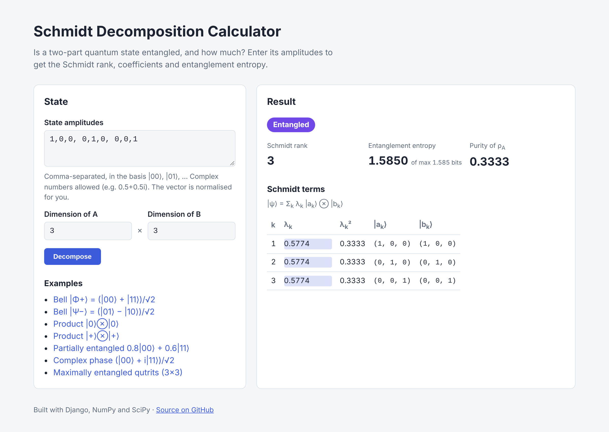

# Schmidt Decomposition Calculator

[](https://github.com/Cezioor/schmidt-calculator/actions/workflows/tests.yml)


A Django web app that tells you whether a two-part (bipartite) quantum state is entangled, and how strongly.
Enter the state's amplitudes and get its **Schmidt rank**, **Schmidt coefficients**, **entanglement entropy**
and the full decomposition into local basis vectors.



## Features

- Any system size from 2 × 2 (two qubits) up to 8 × 8, not only qubits
- Complex amplitudes (`0.5+0.5i`, `1j`, …) and automatic normalisation
- Schmidt rank, coefficients λₖ, entanglement entropy (with its maximum for the given dimensions) and purity of the reduced state
- The Schmidt vectors |aₖ⟩ and |bₖ⟩ for every term
- One-click examples: Bell states, product states, a partially entangled state, a complex phase, qutrits
- Clear validation messages instead of crashes (wrong number of amplitudes, zero vector, unreadable input)
- Light and dark mode, works on phones

## The maths

Any pure state of a system split into parts A and B can be written as

$$
|\psi\rangle = \sum_{k=1}^{r} \lambda_k \, |a_k\rangle \otimes |b_k\rangle, \qquad \lambda_k > 0, \quad \sum_k \lambda_k^2 = 1
$$

where $\{|a_k\rangle\}$ and $\{|b_k\rangle\}$ are orthonormal. The number of terms $r$ is the **Schmidt rank**:
$r = 1$ means a product state, $r > 1$ means the state is entangled.

To compute it, the amplitudes $\psi_{ij}$ are reshaped into a $d_A \times d_B$ matrix $M$, and its
**singular value decomposition** $M = U \Sigma V^\dagger$ gives everything at once: the singular values are
the coefficients $\lambda_k$, the columns of $U$ are $|a_k\rangle$ and the rows of $V^\dagger$ are $|b_k\rangle$.

From the coefficients the app also reports

- **entanglement entropy** $S = -\sum_k \lambda_k^2 \log_2 \lambda_k^2$, from 0 (product) to $\log_2 \min(d_A, d_B)$ (maximally entangled)
- **purity** of the reduced state $\mathrm{Tr}(\rho_A^2) = \sum_k \lambda_k^4$, equal to 1 only for product states

The core logic lives in [`calculator/schmidt.py`](calculator/schmidt.py) and does not depend on Django, so it can
be reused in a notebook or a script.

## Run it locally

Requires Python 3.12+.

```bash
git clone https://github.com/Cezioor/schmidt-calculator.git
cd schmidt-calculator
python -m venv .venv
source .venv/bin/activate        # Windows: .venv\Scripts\activate
pip install -r requirements.txt
python manage.py runserver
```

Open http://127.0.0.1:8000/. The app is stateless, so no database or migrations are needed.

## Tests

```bash
pip install -r requirements-dev.txt
pytest
ruff check .
```

The tests check the maths against known results (Bell states have entropy 1, product states have rank 1,
maximally entangled qutrits reach log₂3), that a random complex state is rebuilt exactly from its decomposition,
and that the web form rejects bad input. GitHub Actions runs them on every push for Python 3.12 and 3.13.

## Project structure

```
calculator/
├── schmidt.py      # the maths: parsing, normalisation, SVD, entropy (no Django)
├── forms.py        # input validation
├── views.py        # one view: validate, compute, render
├── templates/      # HTML
├── static/         # CSS
└── tests/          # pytest suite for the maths and the views
config/             # Django settings and URLs
```

## Background

The calculator started as my part of a group Django project in the Quantum Information Technology
programming course at the University of Gdańsk, and was then rewritten as a standalone app with tests,
input validation and a fuller decomposition output.

## License

MIT, see [LICENSE](LICENSE).
